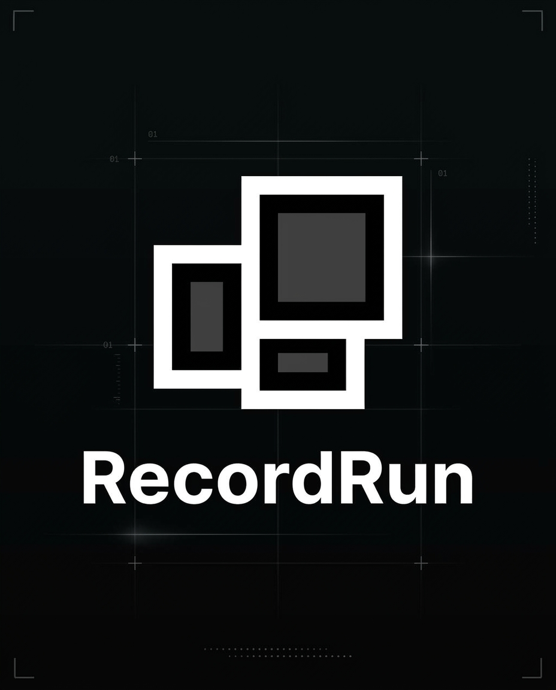

RecordRun - record and replay mouse and keyboard input (Windows)
Copyright (C) 2026 FaveryX - GPL-3.0-or-later (see LICENSE.txt)

Download and install
Go to the Releases page.
Download RecordRun-Setup.exe (installer, recommended) or RecordRun.exe (portable, no install needed).
Run it. Windows may show an "unknown publisher" warning because the app is not code-signed. Click More info, then Run anyway.

BUILD THE INSTALLER
1. Keep all files together in one folder.
2. Double-click build-installer.bat
   (if .NET 8 SDK or Inno Setup is missing it installs them; then close the window and run it again).
3. Your installer: installer\RecordRun-Setup.exe

USE
Record -> Stop recording -> Play / Pause / Stop. Set repeat count, infinite loop and delay first.
Save / Load keeps recordings in %AppData%\RecordRun\Recordings (Load lets you rename or delete).
Emergency stop: Ctrl+Alt+F12.
Run as administrator to control elevated windows.

License

Copyright (C) 2026 FaveryX

RecordRun is free software, licensed under the GNU General Public License v3.0 or later. See LICENSE.txt. It bundles the .NET runtime (MIT license); see THIRD-PARTY-NOTICES.txt.

Published by FaveryX.
